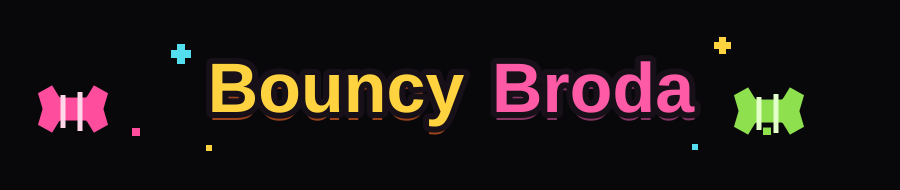
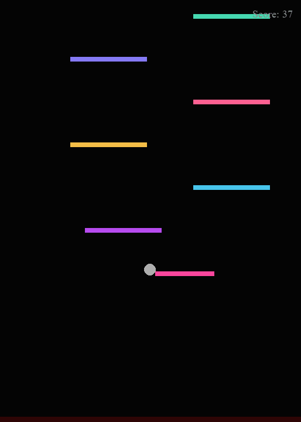

<h1 align="center">
  
</h1>

## rebota.

<p align="center">
  
</p>

Cada rebote suma un punto. Llega a **70** para ganar. Si la pelota cae fuera de la pantalla, la partida termina.

## Controles

| Tecla | Acción |
| --- | --- |
| `A` / `D` | Mover la pelota a izquierda y derecha |
| `W` / `Espacio` | Activar el impulso tras el primer rebote |
| `P` | Pausar o reanudar |
| `Esc` | Salir |

## Ejecutar en Windows

Necesitas Python y estas dependencias:

```powershell
python -m venv .venv
.\.venv\Scripts\Activate.ps1
python -m pip install pygame numpy pywin32
python files\main.py
```

También puedes abrir `Bouncy_Broda.pyw` desde el explorador de archivos.

---

README, logotipo y demo preparados con asistencia de IA. El GIF muestra el juego original desde un estado intermedio, con controles A/D preparados; el código del juego no se modificó.
