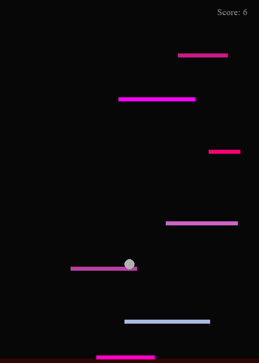

<div align="center">
  
  <h1>Bouncy Broda</h1>
  <p>Un arcade de reflejos: guía la pelota, encadena rebotes y trata de llegar a 70 puntos.</p>
</div>

## Una partida en marcha



La partida termina al caer fuera de la pantalla. Cada rebote suma un punto; alcanza **70 puntos** para ganar.

## Controles

| Tecla | Acción |
| --- | --- |
| `A` / `D` | Mover la pelota a izquierda y derecha |
| `W` / `Espacio` | Activar el impulso tras el primer rebote |
| `P` | Pausar o reanudar |
| `Esc` | Salir |

## Ejecutar en Windows

Necesitas Python y estas dependencias:

```powershell
python -m venv .venv
.\.venv\Scripts\Activate.ps1
python -m pip install pygame numpy pywin32
python files\main.py
```

También puedes abrir `Bouncy_Broda.pyw` desde el explorador de archivos.

---

README y material visual preparados con asistencia de IA. El código del juego no se modificó.

